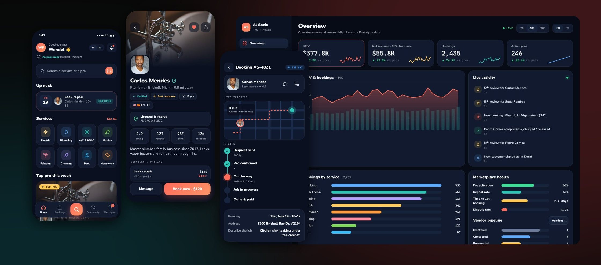

# Al Socio

**Home services in Miami run on WhatsApp and word of mouth. Al Socio gives them structure.**

Al Socio is a bilingual (EN/ES) two-sided marketplace for home services in Miami: verified, licensed pros with upfront prices, booking in three taps, live job tracking and a neighbourhood community. This repo has interactive prototypes of both sides of the marketplace.

**Live case study:** https://www.wendelfreitas.com/cases/al-socio

| | Path | Live |
|---|---|---|
| Customer app (iOS-style, EN/ES) | [`app/index.html`](app/index.html) | [/al-socio/app/](https://www.wendelfreitas.com/al-socio/app/) |
| Operator command centre | [`ops/index.html`](ops/index.html) | [/al-socio/ops/](https://www.wendelfreitas.com/al-socio/ops/) |
| Case-study page (EN/ES/PT) | [`site/case.html`](site/case.html) | [/cases/al-socio](https://www.wendelfreitas.com/cases/al-socio) |

## Customer app
- **Home:** live count of pros near you, neighbourhood picker, 8 colour-coded categories, next booking, top pro, verified pros near you.
- **Find:** search, category chips, sort by rating, distance, price or response time, and an "available today" filter.
- **Pro profile:** licence and insurance, rating, completion and response stats, services with per-service pricing, availability, a work gallery, reviews, save and share.
- **Book in 3 steps:** the job (service, description, photos, urgency), when and where (date strip, 2-hour windows, address), then review (estimate, promo code `VECINO10`, Apple Pay or card). Pending requests auto-confirm a few seconds later.
- **Booking detail:** five-step status timeline, live ETA mini-map, reschedule, two-tap cancel and a "simulate next step" control for demos.
- **Rate and tip:** stars, quick tags, comment, tip and share to Community.
- **Community:** before/after drag sliders, likes (double-tap), comments, new posts with a tagged pro, and a Book button on every post.
- **Messages:** bilingual chat with quick replies and context-aware auto-replies.
- **Profile:** live EN/ES switch, saved pros, payment, notifications, referral and a "Become a pro" application (0% commission for 90 days).

URL options: `?lang=es`, `?embed` (frameless for iframes), `?screen=home|find|plumbing|pro|book|track|rate|chat|apply`. The app also accepts `postMessage({as:'lang',v:'es'})` and `postMessage({as:'go',v:'track'})` from a parent page.

## Ops command centre
GMV, net revenue at the 18% take rate, bookings and active pros over 7, 30 or 90 days. It also has an interactive trend chart, a live activity feed, bookings by service, marketplace health, a sortable and filterable bookings table, a drag-and-drop vendor pipeline (identified → contacted → responded → demo booked → onboarded) with add vendor, dispute resolution and supply density by neighbourhood. It is responsive, with a bottom tab bar on phones. **All numbers are illustrative prototype data.**

## Model
- 18% take rate on completed jobs only
- 0% commission for a pro's first 90 days
- Bilingual by default

## Tech
Each surface is a single HTML file with no framework or build step. Photos come from [Unsplash](https://unsplash.com). `scripts/build_site.py` generates the trilingual case page. Screenshots in `docs/` were rendered with headless Chrome.

Built by [Wendel Freitas](https://www.wendelfreitas.com) with Claude.

## Deploy notes
- `site/case.html` → `public_html/al-socio/case.html`, served at `/cases/al-socio` by `deploy/cases/.htaccess` (placed at `public_html/cases/.htaccess`; all other `/cases/*` routes fall back to the site app).
- `app/` and `ops/` → `public_html/al-socio/app/` and `/ops/` (embedded by the case page). `/al-socio/` redirects to `/cases/al-socio`.
